# Simple Memory architecture (`DESIGN.md`)

`simple-memory` (`sm`) is a single-binary Rust CLI (`rust/`, built with Rust `1.99.1` and bundled SQLite) designed to balance three costs for coding-agent memory: fast capture, predictable lexical ranking, and zero-daemon maintenance.

## Design trade-offs

| Axis | Decision | Trade-off |
|---|---|---|
| Write path | Single transaction via `sm put`, `sm amend`, `sm retire`, or batch importers (`tasklog`, `handoff`, `automemory`, `capture`), redacting secrets before SQLite write | Agents must supply an evidence `--tag` (and `--evidence` for `executed` / `verified`); `sm amend` is append-only (new ULID + supersede in one transaction) |
| Retrieval | Exact ref match > word-boundary phrase > accented hit > BM25 scaled by (bias + recency), active-first under `--include-history`, with `-term` exclusions, match-centered snippets (`rust/src/core/rank.rs` `match_snippet`), absolute or relative `--since`/`--until` (`sm_epoch`), `--source` prefix ranges (`items_source`), and newest-first `sm list` | No vector index; cross-vocabulary synonyms require `[keyword_aliases]` |
| Maintenance | Detached one-pass `sm import catch-up` launched by `sm hook prompt` every `[catch_up] interval_minutes` (default `10`), plus explicit `sm doctor` / `sm upkeep` | Near-duplicate prose stays until `sm supersede`, `sm retire`, or `sm upkeep --report` review; `put_overlaps` warns on 24 h `task`/`handoff` items and top-10 same-repo durable items (`fact`/`decision`/`learning`) |

## Storage and dual FTS5 indexes

All state lives in `$SIMPLE_MEMORY_HOME/memory.db` (default `~/.simple-memory/memory.db`) in SQLite WAL mode with `foreign_keys = ON`. Schema migrations `rust/migrations/0001_init.sql`, `0002_indexes.sql` and `0003_dedupe_per_file.sql` (versioned via `PRAGMA user_version = 3`) create `items`, dual FTS5 tables, triggers, and secondary indexes on `(status, repo)`, `source`, and partial `superseded_by WHERE superseded_by IS NOT NULL`:

```sql
CREATE TABLE items (
  id            TEXT PRIMARY KEY,   -- m_<ulid>, or legacy:<id>
  repo          TEXT NOT NULL,      -- git repo key, 'global', or 'unassigned'
  kind          TEXT NOT NULL,      -- fact, decision, learning, episode, task, handoff
  title         TEXT NOT NULL,
  body          TEXT NOT NULL,
  refs          TEXT NOT NULL DEFAULT '',
  tags          TEXT NOT NULL DEFAULT '',
  source        TEXT NOT NULL DEFAULT '',
  tag           TEXT NOT NULL,      -- executed, verified, decided, client-stated, derived, assumed, prior, planned (legacy: n/a)
  evidence      TEXT NOT NULL DEFAULT '',
  as_of         TEXT NOT NULL,      -- ISO 8601 local timestamp (SM_UTC_OFFSET or OS localtime_r)
  status        TEXT NOT NULL DEFAULT 'active',  -- active or superseded
  superseded_by TEXT,
  content_hash  TEXT NOT NULL
);
-- one active body per repo among items no file backs; a task log or handoff item (task:*, handoff:*), or one amended by hand (amended:task:*, amended:handoff:*), dedupes only within its own source
CREATE UNIQUE INDEX items_dedupe ON items(repo, content_hash,
  CASE WHEN substr(source, 1, 5) = 'task:' OR substr(source, 1, 8) = 'handoff:'
    OR substr(source, 1, 13) = 'amended:task:' OR substr(source, 1, 16) = 'amended:handoff:'
    THEN source ELSE '' END) WHERE status = 'active';
```

SQLite `INSERT`/`UPDATE`/`DELETE` triggers keep two FTS5 virtual tables synchronized inside every write transaction:

1. `items_fold` (`tokenize='unicode61'`): indexes output of deterministic SQL function `sm_fold` (replaces `Đ`/`đ` -> `d`, decomposes NFD, strips combining marks) across `refs`, `title`, `tags`, `body`. Ensures `dorde` matches `Đorđe` and `cafe` matches `café`.
2. `items_raw` (`tokenize='unicode61 remove_diacritics 0'`): preserves diacritics on `title` and `body` so accented queries rank exact-accent hits higher without using a stemmer (`porter` is avoided because it conflates distinct words across non-English text; 4+ ASCII letter words use FTS prefix terms `"word"*` instead).

## Ontology and retrieval gate

Retrieval operates over a two-layer ontology: SQLite `items` columns (`kind`, evidence `tag`, `repo`, `refs`, `source`, `as_of`) plus the hierarchical `[scopes]` tree in `~/.simple-memory/config.toml` (company, client, and project levels with automatic ancestor roll-up mapping to `"repo:<name>"` or case-sensitive whole-word codes such as `"GLX"`). Both entry surfaces converge on `rust/src/store/search.rs` and `rust/src/core/rank.rs`:



## Ranking and default bias

`rust/src/core/rank.rs` (`parse_query_exclusions`, `score_candidates`) splits unquoted `-term` and `-"phrase"` exclusions out of the positive query (stripping standalone uppercase `OR`/`AND` tokens while keeping hyphenated tokens such as `rate-limit` positive), extracts reference tokens (`refs`), builds an `OR` FTS5 query expanded by `[keyword_aliases]`, gathers top candidates from both FTS indexes plus exact ref matches (`FTS_CANDIDATE_LIMIT = 50`, widened to `BIASED_CANDIDATE_LIMIT = 100` whenever any tag, kind, `scope:<path>` bias, or exclusion is active and `--recent` is off), adds with `--recent` off the top matches of the `AND` form of a query of two or more terms (so an item that holds every term is not cut by one-term matches; in the `AND` form, which `--recent` also tries first, each `[keyword_aliases]` key the query names becomes one `OR` group of the key and its targets), removes candidates matching any excluded term or phrase across folded `refs + title + tags + body` (fetching again 4 times wider while a full fetch keeps fewer FTS matches than the pool cap), and sorts descending by:

```text
(active, ref_hits, phrase_hit, accent_hit, score, as_of_epoch, id)
```

where `active = u8::from(item.status == "active")` keeps active items ahead of superseded and retired rows when `--include-history` is enabled (with no change on default active-only queries), normalized BM25 uses column weights `refs = 10.0`, `title = 5.0`, `tags = 3.0`, `body = 1.0`, and:

```text
score = bm25_scaled * (1 + recency_boost + 0.3 * matched_bias_count + accent_boost) + current_repo_boost - legacy_penalty - unassigned_penalty
```

- `recency_boost`: `0.3 * 0.5^(age_days / 30.0)` when `"recency"` is in active bias (`RECENCY_MAX_BOOST = 0.3`, `RECENCY_HALF_LIFE_DAYS = 30.0`).
- `DEFAULT_BIAS`: `["recency", "fact", "decision", "learning", "executed", "verified", "decided", "client-stated"]`, scaling normalized BM25 by `1.6x` (+ recency) for durable verified/decided facts/decisions/learnings, `1.3x` (+ recency) for durable derived items or executed tasks, and `1.0x` (+ recency) for ephemeral `handoff`/`episode` notes (`bm25_scaled = 1.0` when `max_rel` is `0.0`).
- `scope:<path>` bias: `parse_bias` normalizes the `scope:` prefix to lowercase while preserving `<path>` case (for example `--bias scope:acme/GLX`), resolving matchers from `[scopes]` on demand (`rust/src/service/query.rs::resolve_scope_biases`). When explicit `--bias` contains only `scope:<path>` tokens, `rust/src/service/query.rs::prepare` merges them additively on top of `[query] default_bias` (passing `relevance` or any explicit kind, tag, or recency token keeps replacement behavior, such as `--bias relevance,scope:acme/GLX`). Each matched `scope:<path>` appends to `bias_hits`, adding `+0.3` (`BIAS_BOOST`) to the BM25 multiplier (outranking `CURRENT_REPO_BOOST = 0.05` at comparable BM25 without overriding exact `ref_hits`, `phrase`, or `accent`), widens the FTS pool to `BIASED_CANDIDATE_LIMIT = 100`, emits `why=bias:scope:<path>` (and JSON `why.bias`), and evaluates word matchers via `rust/src/core/terms.rs::stands_as_word` for exact parity with SQL `sm_word`.
- Overridable globally in `~/.simple-memory/config.toml` under `[query] default_bias` or per call via `--bias` (including `scope:<path>`; `--bias relevance` disables recency and tag/kind boosts while still permitting explicit `--bias relevance,scope:<path>`, `[query] default_bias = ["relevance"]` also suppresses automatic hook scope bias, and `--recent` switches to AND-first chronological retrieval).
- No term-coverage tier: the sort key has no rank for how many query terms an item holds. Two such tiers (an idf-weighted count of held terms, all-terms-first) were compared blind with this order on a real query log; on queries of three or more terms this order was rated better (15 better, 2 worse, 12 tie; 8 better, 0 worse, 5 tie). Their only clear gain was in synthetic stores of many one-word items, where BM25 length weighting ranks a longer item that holds more of the query below them.

## Locks, deadlines, and hook budgets

- **Write lock wait** (`rust/src/store/connect.rs`): `PRAGMA busy_timeout` caps at `BUSY_TIMEOUT_MS = 5000`, while `BEGIN IMMEDIATE` and migrations loop in `LOCK_WAIT_SLICE_MS = 100` wall-clock slices up to `WRITE_LOCK_WAIT_S = 15.0` (avoiding SQLite sleep-counter drift under load).
- **Prompt hook budget** (`rust/src/service/recall.rs`): End-to-end execution is bounded by `HOOK_BUDGET_S = 12.0` (safely inside the `15` second harness timeout configured by `sm hooks print`). If `claude -p` errors, times out, or hits backoff (10 minutes after 2 consecutive failures, automatically invalidated when `claude_bin`, `model`, or `timeout` changes), `sm hook prompt` falls back to local IDF keyword scoring (`LOCAL_TAU = 8.0` in `rust/src/service/query.rs`) using built-in English stopwords plus `[prompt_hook] extra_stopwords`, and enforces `[prompt_hook] local_min_idf` (default `8.0`; `0.0` disables) as the local IDF floor. On the Haiku path, when `[prompt_hook] min_idf > 0.0` (default `3.0`) and the scope has at least `20` active items, hits without an exact ref match whose matched-term IDF sum (across query and `[keyword_aliases]` terms, deduplicated per item by prefix overlap) falls below `min_idf` are dropped and logged under `floor_dropped` in `hook.log` (`min_idf = 0.0` takes the `run_query` fast path). Both paths include the item's evidence `tag` on each injected line, union matching `[scopes]` matchers additively with the `cwd` repo via `matching_scope_paths` whenever the prompt or rewritten query names a configured `[prompt_hook.projects]` code mapped in `[scopes]`, and attach those matched paths as automatic `scope:<path>` soft biases (`+0.3` via `BIAS_BOOST`) across Haiku (`min_idf > 0.0` and `min_idf = 0.0`) and local (`local_query_at`) runs unless `[query] default_bias = ["relevance"]` is configured.
- **No long transactions across I/O**: Model calls in `rust/src/service/capture.rs` and file scans in `rust/src/service/import_.rs` finish before opening short SQLite transactions.

## Code layout and layer rules

```text
rust/
├── migrations/
│   ├── 0001_init.sql            SQLite tables, FTS5 indexes, triggers
│   ├── 0002_indexes.sql         B-tree indexes on (status, repo), source, partial superseded_by
│   └── 0003_dedupe_per_file.sql items_dedupe also keys task log and handoff items, amended or not, by source
├── src/
│   ├── core/                    pure domain logic: fold, refs, terms (stands_as_word), rank, tags, item, redact, dedup
│   ├── store/                   all SQLite queries: connect, items, search, related, stats, transfer, upkeep
│   ├── sources/                 parsers: tasklog, handoff, automemory, transcript, proposal, legacy, turns (test-only)
│   ├── service/                 command orchestration: put, query, list, show, related, supersede, retire, amend, recall, capture, catchup, import_, upkeep, doctor, stats, transfer, backup, setup, usage, mcp
│   ├── cli/                     parser (args.rs), formatting, process entrypoint
│   ├── py/                      CPython-compatible text, TOML, YAML, JSON, table, path helpers
│   ├── clock.rs                 SM_UTC_OFFSET and thread-safe OS localtime_r formatting
│   ├── config.rs                defaults, TOML merge/comment serializer, [scopes], repo resolution
│   └── parity.rs                `--features parity` test driver hook (excluded from release binary)
└── tests/                       unit + CLI integration tests + fixtures/
npm/
├── simple-memory/               Node 18+ launcher (bin/sm.js), target resolver (lib/platform.js), update check (lib/update.js, scripts/check-update.js), postinstall fallback
├── platforms/<os>-<arch>/       optional-dependency native binary packages (darwin-arm64, darwin-x64, linux-*)
└── test/                        wrapper, update check, postinstall, and staging tests (npm_wrapper.test.mjs)
```

Dependencies flow downward (`cli` -> `service` -> `store`/`sources`/`config` -> `core`; all layers may use `py`, `clock`, `error`) with three small helper exceptions (`rust/src/config.rs` -> `service::capture`, `rust/src/config.rs` -> `service::query::LOCAL_TAU`, `rust/src/config.rs` -> `sources::iterate`); `stands_as_word` lives in `rust/src/core/terms.rs` so `rust/src/store/connect.rs` (`sm_word`) and `rust/src/service/recall.rs` both call into `core`. Explicit `#[cfg(test)]` / `#[cfg(any(test, feature = "parity"))]` gates keep test helpers out of release binaries.

The npm wrapper (`npm/simple-memory/bin/sm.js`) sets `SM_INSTALL_METHOD=npm` in the child environment so `sm update` detects npm installs, forwards stdout directly (`stdio: "inherit"`), and after a normal child exit (`!signal`) calls `npm/simple-memory/lib/update.js` (`maybeNotifyAndRefresh`). On interactive TTY stderr (skipping non-TTY streams, `CI`, `SM_NO_UPDATE_CHECK=1`, `mcp`, `hook`, `hooks`, `update`, `--format json`, `--version`/`-v`, and `--help`/`-h`), it reads `$SIMPLE_MEMORY_HOME/update-check.json` (fallback `~/.simple-memory/update-check.json`), writes a one-line notice to stderr when a newer `major.minor.patch` version is cached, and spawns detached `unref()`'d `npm/simple-memory/scripts/check-update.js` whenever the cache is missing or at least 24 hours old (3-second timeout, atomic temp-file rename write, silent exit 0 on any network or filesystem error).

## Verification suite

- `scripts/dead_code_scan.sh rust`: Rewrites crate visibility in a scratch copy and compiles with `--force-warn dead_code` so release builds ship zero unreachable code.
- `scripts/smoke.sh`: Exercises `init`, `put`, `query`, `show`, `doctor`, `import catch-up`, `hook prompt`, and `backup` in an isolated scratch home with no external `claude` CLI on `PATH`.
- `scripts/test_scripts.sh`, `node --test npm/test/npm_wrapper.test.mjs`, & `.github/workflows/rust.yml`: Verifies shell scripts, npm wrapper behavior, and Rust suites across Linux (`ubuntu-latest`) and macOS (`macos-latest`).
