# simple-memory (`sm`)

[](LICENSE)
[](rust/rust-toolchain.toml)
[](DESIGN.md)
[](#mcp-server-sm-mcp)

A single-binary SQLite + FTS5 memory store, prompt hook, and MCP server for coding agents.

Store verified facts and architectural decisions from the shell with no embeddings or background daemons. Inject matching context automatically via prompt hooks in Claude Code and `agy` (Antigravity CLI), or query and write on demand from any MCP client.



## Why simple-memory

- **One local SQLite file**: No external database, daemon, or embedding service; everything stays in `~/.simple-memory/memory.db` (WAL mode, bundled SQLite).
- **Evidence-tagged records**: Items store an evidence tag, kind, local timestamp, and extracted references (tickets, commits, paths).
- **Signal-first default ranking**: Exact references rank first, then exact phrases, accented matches, and weighted BM25 biased toward durable verified/decided records.
- **Dual folded and raw FTS5 search**: Folds accents (`dorde` finds `Đorđe`, `cafe` finds `café`) while scoring exact accents higher and prefix-matching 4+ letter ASCII words.
- **Automatic catch-up without cron**: The prompt hook triggers one background pass at most every 10 minutes to rotate checked backups (every 24 h, keep 7), import task logs/handoffs/memory files, and summarize idle sessions.

## Install

Install globally via npm (Node.js 18+) and initialize `~/.simple-memory/`:

```sh
npm install -g simple-memory
sm init
```

You can also run one-off commands without a global install:

```sh
npx simple-memory --help
```

Prebuilt native Rust binaries ship through npm optional dependencies for macOS (`arm64` via `simple-memory-darwin-arm64`, `x64` via `simple-memory-darwin-x64`). On Linux (`x64` and `arm64`), `postinstall` falls back to GitHub Release tarballs when published; otherwise install from source with `./scripts/install.sh` below.

Install globally with `npm install -g simple-memory` (not `npx`) before running `sm hooks print`, so hook and MCP configs point to a stable path. Make sure `node` is on the `PATH` seen by your hook and MCP hosts, or install the standalone native binary via `./scripts/install.sh` for minimal-`PATH` GUI hosts.

### Upgrading

Check for a newer release or upgrade with `sm update`:

```sh
sm update --check   # check npm for a newer version and refresh the local cache
sm update           # run npm install -g simple-memory@latest for npm installs, or print the source-upgrade command
```

Interactive npm CLI runs also read `$SIMPLE_MEMORY_HOME/update-check.json` (refreshed in the background at most once every 24 hours) and print a one-line notice to stderr when a newer release exists. The reminder stays silent on non-TTY streams, CI, `mcp`, `hook`/`hooks`, `update`, `--format json`, `--version`/`-v`, `--help`/`-h`, or when `SM_NO_UPDATE_CHECK=1` is set.

### Build from source (Linux or custom Rust build)

Requires [Rust (`rustup`)](https://rustup.rs/). `rust/rust-toolchain.toml` pins Rust `1.99.1`. Clone your repository copy and run:

```sh
git clone <repo-url>
cd simple-memory
./scripts/install.sh
export PATH="$HOME/.local/bin:$PATH"   # add to your shell profile if needed
sm init
```

`./scripts/install.sh` builds the release binary from `rust/`, atomically installs `sm` (plus a `simple-memory` symlink) to `SM_INSTALL_DIR` (default `~/.local/bin`), honors `CARGO_TARGET_DIR`, and verifies `sm --version`.

<details>
<summary>Manual install and atomic replacement</summary>

Build and replace via a temporary sibling path + `mv -f` rather than overwriting a running binary in place or running `ln -sf`:

```sh
cd rust && cargo build --release --locked
mkdir -p ~/.local/bin
cp target/release/sm ~/.local/bin/sm.new && mv -f ~/.local/bin/sm.new ~/.local/bin/sm
ln -s sm ~/.local/bin/simple-memory.new && mv -f ~/.local/bin/simple-memory.new ~/.local/bin/simple-memory
```

`ln -sf` unlinks the old symlink before relinking (leaving a brief window where a firing hook finds no `sm`), and copying over a mapped binary in place on macOS can break its code signature.

</details>

## 60-second quickstart

Inside any git repository, `sm` automatically scopes writes and queries to that repository (plus `global` and `unassigned` items):

```sh
sm put --kind decision --tag decided --evidence "ADR-004" --refs ADR-004 \
  "Limit HTTP connection pool to 16 sockets per worker"
# m_01M7R350TK1Z1DKWVWT4NSF8MQ

sm put --kind fact --tag verified --evidence "loadtest 10m run, 0 pool waits" --refs ADR-004 \
  "Pool size 16 keeps p99 request latency under 12 ms at peak load"
# m_01M7R350W6QV508RDWBHA9S45W

sm query "connection pool ADR-004"
```

```text
[m_01M7R350TK1Z1DKWVWT4NSF8MQ] #1 repo=my-repo kind=decision tag=decided as_of=2026-11-18T19:46:44+00:00 ~26 tok why=terms:4/4,bias:decision,bias:decided,recent refs=ADR-004
  Limit HTTP connection pool to 16 sockets per worker
[m_01M7R350W6QV508RDWBHA9S45W] #2 repo=my-repo kind=fact tag=verified as_of=2026-11-18T19:46:44+00:00 ~32 tok why=terms:3/4,bias:fact,bias:verified,recent refs=ADR-004
  Pool size 16 keeps p99 request latency under 12 ms at peak load
next: sm show m_01M7R350TK1Z1DKWVWT4NSF8MQ m_01M7R350W6QV508RDWBHA9S45W; sm related m_01M7R350TK1Z1DKWVWT4NSF8MQ
```

`sm query` (alias `sm search`) also accepts unquoted multi-word terms, `-term` or `-"exact phrase"` exclusions (quote the query or use `--` when starting with `-` or excluding multi-word phrases in a shell), and relative `--since` / `--until` bounds (`30m`, `24h`, `7d`, `2w`):

```sh
sm search connection pool -staging --since 7d
```

Open full body and provenance with `sm show` (or `sm show --format json`), update metadata or text append-only with `sm amend`, retire obsolete items with `sm retire`, or replace outdated facts with `--supersedes` (`sm supersede OLD NEW`):

```sh
sm show m_01M7R350TK1Z1DKWVWT4NSF8MQ
sm amend m_01M7R350TK1Z1DKWVWT4NSF8MQ --add-refs ADR-009
# m_01M7R3512K8Q9V4X7B2N6M3P1R
sm retire m_01M7R350W6QV508RDWBHA9S45W --reason "replaced by new benchmark"
sm put --kind decision --tag decided --supersedes m_01M7R3512K8Q9V4X7B2N6M3P1R \
  --evidence "ADR-009" --refs ADR-009 \
  "Raise HTTP connection pool to 24 sockets per worker after read-replica split"
```

`sm put` refuses writes without `--tag`, and requires `--evidence` for `executed` and `verified` items. Duplicate active bodies in the same repo return the existing item ID. When a new item overlaps active work items (`task`, `handoff`) from the last 24 hours or active durable items (`fact`, `decision`, `learning`) in the same repo, `sm put` prints a warning to stderr.

## Agent integrations

Print ready-to-merge JSON for each harness (`sm hooks print` writes no files):

| Harness | Command | Merge target |
|---|---|---|
| Claude Code | `sm hooks print claude-code` | `"hooks"` in `~/.claude/settings.json` |
| Antigravity CLI (`agy`) | `sm hooks print agy` | `~/.gemini/config/hooks.json` |
| Any MCP client | `sm hooks print mcp` | `"mcpServers"` in `.mcp.json` or client MCP config |

Example output of `sm hooks print claude-code`:

```json
{
  "hooks": {
    "UserPromptSubmit": [
      {
        "hooks": [
          {
            "type": "command",
            "command": "/path/to/.local/bin/sm hook prompt",
            "timeout": 15
          }
        ]
      }
    ]
  }
}
```

### How the prompt hook works

1. Skips slash commands, machine-wrapped notifications, and prompts under 3 words.
2. Uses `claude -p` (Haiku, with hooks, tools, and MCP servers off) to turn the prompt into keywords or `NONE`. Set `[prompt_hook] model = "none"` for offline IDF local-keyword search with zero model calls.
3. Falls back to local-keyword search on missing `claude`, error, or timeout (with a 10-minute cooldown after two consecutive failures that clears automatically when `claude_bin`, `model`, or `timeout` changes), skipping built-in English stopwords plus `[prompt_hook] extra_stopwords`.
4. Injects at most 4 short lines carrying repo, kind, evidence tag, date, compact refs, and title (including `--in <scopes>` in the follow-up hint when project scopes match), and tracks shown IDs per session (per compaction epoch in Claude Code, per `conversationId` in `agy`). When the prompt or rewritten query names a configured `[prompt_hook.projects]` code mapped in `[scopes]`, those scope matchers union additively with the current repo and apply automatic `scope:<path>` bias (`+0.3` via `BIAS_BOOST`) on both the Haiku and local paths so cross-repo project notes surface without dropping local matches (opt out of automatic scope bias with `[query] default_bias = ["relevance"]`). On scopes with at least 20 active items, the Haiku path drops low-information hits whose matched-term IDF sum falls below `[prompt_hook] min_idf` (default `3.0`; `0.0` disables via `run_query`; exact ref hits bypass; dropped IDs log under `floor_dropped`). The local fallback applies `[prompt_hook] local_min_idf` (default `8.0`; `0.0` disables) as its local IDF floor. Disable per invocation with `SM_PROMPT_HOOK=0`.

### MCP server (`sm mcp`)

Speaks JSON-RPC 2.0 over stdio (`MCP 2026-07-28` stateless metadata and `2024-11-05` through `2025-11-25` `initialize` handshakes) and serves eight tools:

| Tool | Arguments | Purpose |
|---|---|---|
| `memory_query` | `query`; optional `bias`, `kind`, `tag`, `source`, `since`, `until`, `recent`, `include_history`, `in`, `limit`, `all_repos`, `repo` | Ranked search (`sm query --format json`); `bias` accepts `scope:<path>` |
| `memory_list` | optional `limit`, `offset`, `kind`, `tag`, `source`, `since`, `until`, `status`, `include_history`, `all_repos`, `repo`, `in` | Browse items newest-first without a query |
| `memory_show` | `ids` (non-empty array) | Full body, refs, and provenance per ID |
| `memory_related` | `id`; optional `limit` | Supersede chain, shared refs, same session |
| `memory_put` | `text`, `tag`; optional `kind`, `evidence`, `refs`, `supersedes`, `repo` | Store item, redact secrets, warn on overlaps |
| `memory_amend` | `id`; optional `text`, `title`, `kind`, `tag`, `evidence`, `repo`, `add_refs`, `remove_refs`, `refs`, `add_tags`, `remove_tags`, `tags`, `as_of` | Append-only update (creates a new item and supersedes `id`) |
| `memory_retire` | `id`; optional `reason` | Soft-retire an active item with no replacement |
| `memory_supersede` | `old_id`, `new_id` | Retire `old_id` in favor of `new_id` |

## Ontology and retrieval gate

`simple-memory` organizes notes in a two-layer ontology:

- **Layer 1 (SQLite `items` columns)**: every item stores `kind` (`fact`, `decision`, `learning`, `episode`, `task`, `handoff`), evidence `tag` (`executed`, `verified`, `decided`, `client-stated`, `derived`, `assumed`, `prior`, `planned`), `repo`, extracted `refs`, and `source` provenance.
- **Layer 2 (config `[scopes]` tree)**: `~/.simple-memory/config.toml` groups repos and case-sensitive whole-word project codes (such as `"GLX"`) into a slash-separated hierarchy (company, client, project levels) with automatic ancestor roll-up.

Both prompt-hook recall (`sm hook prompt`) and explicit lookup (`sm query` / `sm mcp`) converge on the same SQL filter, FTS5 + ref candidate pool, and rank/bias gate:



- **Hard scope filter (`--in`)**: `sm query "auth timeout" --in acme/globex` searches across all repos and keeps only items matching `acme/globex` or its descendants.
- **Soft scope bias (`--bias scope:<path>`)**: `sm query "auth timeout" --bias scope:acme/globex` (or MCP `memory_query` `bias`, or `[query] default_bias`) keeps the normal repo result set, widens the FTS candidate pool to `100`, and adds `+0.3` (`BIAS_BOOST`) per matched scope without overriding exact `ref_hits`, `phrase`, or `accent` matches (reported as `why=...,bias:scope:acme/globex`). When `--bias` contains only `scope:<path>` tokens, they merge additively on top of `[query] default_bias` so durable kind, tag, and recency boosts stay active; pass `relevance` or another explicit kind/tag token (such as `--bias relevance,scope:acme/globex`) to replace the defaults. Stack parent and child paths (`--bias scope:acme,scope:acme/globex`) for hierarchical specificity.
- **Automatic hook scope bias**: When `sm hook prompt` matches a `[prompt_hook.projects]` code to `[scopes]`, matched paths union additively into SQL and apply automatic `scope:<path>` bias on both the Haiku and local paths. Set `[query] default_bias = ["relevance"]` to opt out of automatic scope bias (along with recency and kind/tag bias) while keeping additive SQL scope inclusion.

## Multi-repo scopes and maintenance

Group related repos or project codes locally in `~/.simple-memory/config.toml` under `[scopes]`:

```toml
[scopes]
"acme" = ["repo:acme-internal"]
"acme/globex" = ["GLX"]
"acme/globex/portal" = ["repo:globex-portal"]
```

Filter hard across scopes with `sm query "auth timeout" --in acme/globex`, soft-boost a scope without filtering via `sm query "auth timeout" --bias scope:acme/globex`, and inspect active, superseded, and retired store counts, recall open rates, catch-up runs, and scope totals with `sm stats` (`--days N`, `--format json`).

Check store health anytime:

```sh
sm doctor --imports     # check DB integrity and list unimported task logs, handoffs, memory files
sm upkeep --report      # read-only report of near-duplicates and stale planned/assumed items
sm backup               # verified SQLite backup copy in ~/.simple-memory/backups/
```

## Extending simple-memory

Modules follow a downward architecture (`cli` -> `service` -> `store` / `sources` / `config` -> `core`, plus shared `py`, `clock`, `error`), with three explicit helper edges (`rust/src/config.rs` -> `service::capture`, `rust/src/config.rs` -> `service::query::LOCAL_TAU`, and `rust/src/config.rs` -> `sources`; `stands_as_word` lives in `rust/src/core/terms.rs`):

- **Custom stopwords and ranking defaults**: Set `[prompt_hook] extra_stopwords` for domain/language filler skipped by the local fallback, and `[query] default_bias` to override default ranking without recompiling.
- **New import source**: Add a parser under `rust/src/sources/` returning `core::item::Item` records, register its subcommand in `rust/src/cli/args.rs` and `rust/src/service/import_.rs`, and wire it into `rust/src/service/catchup.rs` + `rust/src/service/doctor.rs` (`--imports`).
- **New MCP tool or schema field**: Add tool schemas and handlers in `rust/src/service/mcp.rs` over shared `service/*` calls; place numbered `.sql` migrations under `rust/migrations/` and register them in `rust/src/store/connect.rs`.
- **Additional redaction patterns**: Extend `rust/src/core/redact.rs` with linear-time regex patterns and unit tests.

<details>
<summary>CLI command reference</summary>

| Command | Summary |
|---|---|
| `sm init` | Create home dir, `memory.db`, and commented `config.toml` |
| `sm config` | Print effective configuration (defaults plus `config.toml`) as TOML |
| `sm put TEXT --tag TAG [...]` | Store item (`--kind`, `--evidence`, `--refs`, `--tags`, `--supersedes`, `--repo`, `--as-of`) |
| `sm query TEXT [...]` (alias `sm search`) | Ranked search with unquoted terms, `-term`/`-"phrase"` exclusions, relative `--since`/`--until` (`30m`, `24h`, `7d`, `2w`), additive `--bias scope:<path>`, `--limit`, `--recent`, `--kind`, `--tag`, `--source`, `--in` (mutually exclusive with `--repo`), `--all`, `--include-history`, `--format` |
| `sm show ID [ID ...] [--format text\|json]` | Print full text and provenance (`text` or `json` array); exits 1 if any ID is missing |
| `sm related ID [...]` | Show supersede chain, shared-ref items, and same-session items |
| `sm supersede OLD NEW` | Mark `OLD` superseded by `NEW` |
| `sm retire ID [--reason TEXT]` | Soft-retire an active item with no replacement (default reason: `manual`) |
| `sm amend ID [...]` | Append-only update: create a new item with changed fields and supersede `ID` atomically |
| `sm list [...]` | Browse items newest-first without a query (`--limit`, `--offset`, `--repo \| --all \| --in`, `--kind`, `--tag`, `--source`, `--since`, `--until`, `--status \| --include-history`, `--format`) |
| `sm import tasklog\|handoff\|legacy\|proposal PATH` | Import YAML task logs, Markdown handoffs, legacy DBs, or proposal JSONL (`--apply`, `--dry-run`) |
| `sm import automemory \| sessions \| jsonl \| catch-up` | Sync Claude memory files, summarize idle sessions, import JSONL, or run full catch-up |
| `sm export [--include-history] [--repo R \| --all]` | Dump items sorted by ID as JSONL to stdout |
| `sm upkeep [--dry-run] [--report]` | Retire older/claimed session handoffs; `--report` flags near-duplicates and stale items |
| `sm backup [--keep N]` | Checked SQLite backup in `backups/` |
| `sm doctor [--rebuild-fts] [--backfill-refs] [--imports]` | Verify SQLite integrity, rebuild FTS5, backfill refs, or audit unimported files |
| `sm stats [--days N] [--format text\|json]` | Store counts (active, superseded, retired), recall open rate, catch-up runs, backups, and `[scopes]` rollup |
| `sm hook prompt [--agy]` | Harness hook reading prompt JSON on stdin |
| `sm hooks print claude-code\|agy\|mcp` | Print harness configuration JSON to stdout |
| `sm mcp` | Run JSON-RPC 2.0 MCP server on stdio |
| `sm update [--check]` | Check npm for a newer release and upgrade npm installs (or print the source-upgrade command) |
| `sm --version`, `sm -v` | Print installed binary version |

</details>

<details>
<summary>Configuration and environment variables</summary>

`sm init` writes a commented template to `~/.simple-memory/config.toml` and never overwrites an existing file:

- `[repos] roots`: Parent directories whose direct children map workspace/transcript folders to repo keys (`[repo_aliases]` maps aliases such as worktrees).
- `[keyword_aliases]`: Query term expansions (e.g. `"k8s" = "kubernetes"`).
- `[query] default_bias`: Default is `["recency", "fact", "decision", "learning", "executed", "verified", "decided", "client-stated"]`. Accepts the same tokens as `--bias`, including `scope:<path>` (for example `"scope:acme/globex"`). Explicit `--bias` with only `scope:<path>` tokens merges on top of `default_bias`; set `["relevance"]` to disable recency, kind/tag, and automatic prompt-hook scope bias.
- `[prompt_hook]`: `enabled`, `model` (`"haiku"` or `"none"`), `timeout`, `limit`, `claude_bin`, `extra_stopwords`, `min_idf` (default `3.0`; `0.0` disables), `local_min_idf` (default `8.0`; `0.0` disables), and `[prompt_hook.projects]` project codes.
- `[catch_up]`: `enabled`, `interval_minutes` (default `10`).
- `[upkeep]`: `tasklog_roots` and `handoff_dirs`.
- `[capture]`: `enabled`, `root` (`~/.claude/projects`), `idle_minutes`, `since_days`, `min_prompts`, `max_per_run`, `model`, `timeout`, `dialogue_chars`.
- `[automemory]`: `enabled`, `root` (`~/.claude/projects`).
- `[scopes]` and `[backup]`: Path matchers plus backup `interval_hours` (`24`) and `keep` (`7`).

Environment variables:

- `SIMPLE_MEMORY_HOME`: Override `~/.simple-memory`.
- `SM_UTC_OFFSET`: Explicit offset (`+00:00`, `-05:00`, `Z`, `+0530`) overriding OS local timezone (`localtime_r`).
- `SM_PROMPT_HOOK=0`: Disable prompt-hook recall and background catch-up for one process tree (such as subagent runs).
- `SM_BINARY_PATH`: Explicit path to a `sm` binary for the npm wrapper; exits with an error if the path does not exist instead of falling back.
- `SM_SKIP_DOWNLOAD=1`: Skip the npm `postinstall` GitHub Release binary fallback download.
- `SM_NO_UPDATE_CHECK=1`: Disable the npm wrapper's 24-hour interactive update reminder.

</details>

<details>
<summary>Privacy, redaction, and limits</summary>

- **Local by default**: Everything stays in your local `memory.db`. Model calls run only when Claude Haiku is invoked through your local `claude -p` for `[prompt_hook]` query distillation or `[capture]` session cards (disable either in `config.toml`).
- **Automatic write redaction**: `put_item` and `put_items_batch` strip `<private>...</private>` blocks and replace known secret shapes (private keys, cloud access keys, API tokens such as `sk-`/token prefixes, JWTs, bearer tokens, signed URL query parameters, URL credentials, and `password=`-style assignments) with `[REDACTED:<kind>]` before SQLite insert.
- **Redaction limits**: Redaction is pattern-based and best effort; a credential URL is caught in the `user:password@` form, including an empty user (`redis://:password@host`) and a `/` in the password after a user without a dot. It is not caught when the user holds a dot and the password a `/`, when the password starts with `/` or has only digits before its first `/`, when the password holds both `:` and `/` or a quote, or when a bare token stands alone as the user part with no known token shape; text of the form `scheme://word:word/path@suffix` on a host without a dot (such as an scp-style path inside an `ssh://` URL) is replaced as if it were a credential.
- **Known limits**: Search is lexical/prefix-based with configurable `[keyword_aliases]` rather than semantic embeddings; multi-machine sync is manual (copy `memory.db` or files under `backups/`).

</details>

<details>
<summary>Development and testing</summary>

Run all checks with `HOME` and `SIMPLE_MEMORY_HOME` pointed at an empty scratch directory (preserving `RUSTUP_HOME` and `CARGO_HOME`):

```sh
cd rust
cargo fmt --check
cargo build --release --locked
cargo clippy --all-targets --locked -- -D warnings
cargo clippy --all-targets --locked --features parity -- -D warnings
mkdir -p /tmp/sm-test/.simple-memory
env RUSTUP_HOME="${RUSTUP_HOME:-$HOME/.rustup}" CARGO_HOME="${CARGO_HOME:-$HOME/.cargo}" \
  HOME=/tmp/sm-test SIMPLE_MEMORY_HOME=/tmp/sm-test/.simple-memory \
  cargo test --locked --features parity --no-fail-fast
cd ..
TMPDIR=/tmp bash scripts/dead_code_scan.sh rust
TMPDIR=/tmp bash scripts/smoke.sh rust/target/release/sm
TMPDIR=/tmp bash scripts/test_scripts.sh
node --test npm/test/npm_wrapper.test.mjs
```

Note: Avoid colons (`:`) inside scratch `HOME` paths on macOS (`DYLD_FALLBACK_LIBRARY_PATH` treats `:` as a path separator); test custom timezone offsets via `SM_UTC_OFFSET=+05:30`.

</details>

## License

[MIT](LICENSE)
